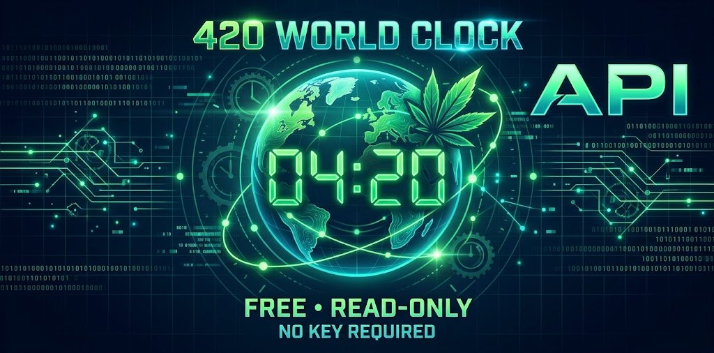

<p align="center"><a href="https://api.420.menow.us/"></a></p>

# The 420 API

**The world's only 4:20 API.** A free, read-only JSON API that tells you where in the world it's 4:20 right now — AM or PM — plus marijuana law status for 197 countries, each with a source.

- **Live:** https://api.420.menow.us/ (the front page is a beginner's tutorial: your first API call, step by step)
- **Reference:** https://api.420.menow.us/docs
- **The map it powers:** https://420.menow.us/

No key, no signup, CORS open. The hosted API is rate-limited to 10 requests a second per IP.

## Try it

```bash
curl https://api.420.menow.us/v1/now
```

```js
fetch('https://api.420.menow.us/v1/now').then(r => r.json()).then(console.log)
```

```python
import requests
now = requests.get('https://api.420.menow.us/v1/now').json()
print(now['next']['place'], 'in', now['next']['minutes_until_next_420'], 'minutes')
```

## Endpoints

| Endpoint | What you get |
|---|---|
| `GET /v1/now` | Zones at 4:20 right now, the closest, the next, seconds left in the minute |
| `GET /v1/zones` | Every zone ranked by distance from 4:20 |
| `GET /v1/zones/{tzid}` | One zone: its local time and distance from 4:20 |
| `GET /v1/zones/{tzid}/law` | The local law card for one zone (e.g. `America/Los_Angeles`) |
| `GET /v1/zones/{tzid}/places` | Places in that zone with their own law cards |
| `GET /v1/laws` | Law status for every country |
| `GET /v1/laws/{ISO2}` | One country (e.g. `NL`, `TH`, `US`) |
| `GET /v1/time` | Server time, checked against the US Naval Observatory |
| `GET /v1/meta` | Data date, tz database version, SQLite size and SHA-256 |
| `GET /v1/laws.sqlite` | The whole law database as one SQLite file, for offline apps |

## The law data

Status symbols: ✓ legal · ◐ decriminalized · ⚕ medical only · ⊘ illegal · ☠️ death sentences given.

- **Legal** means adult possession is lawful. Where possession is tolerated but fined in public, the country is marked **decriminalized** instead.
- **☠️** marks only the 18 countries where a death sentence has actually been handed down for marijuana, not every country whose statute book allows one.
- Every country carries the sources behind its call. **Corrections are welcome — open an issue with a source.**

Information and education only — not legal advice. Laws change; check official sources before you travel.

## Run it yourself

```bash
docker compose up --build
# → http://localhost:8000/
```

Or without Docker:

```bash
python3 -m venv .venv && . .venv/bin/activate
pip install -r requirements.txt
PYTHONTZPATH= DATA_DIR=data uvicorn main:app --app-dir app --port 8000
```

Time is computed from the pinned `tzdata` package (`PYTHONTZPATH=` in the Dockerfile), so results never depend on the host's zoneinfo. Half-hour and 45-minute offsets (Kathmandu is UTC+5:45) are handled.

## Layout

```
app/main.py                      FastAPI app (all endpoints)
app/static/index.html            the beginner tutorial served at /
data/                            law + zone data the API reads (CC BY 4.0)
tools/cannabis-laws-export.py    regenerates data/ from the MariaDB source database
```

The source of truth is a MariaDB database (`countries`, `zones`, `places`, `sources`, `history`). `tools/cannabis-laws-export.py` turns it into the JSON and SQLite files in `data/`. Set `LAWS_DB_CMD` to whatever command reaches your database.

## Licence

- **Code:** MIT — see [LICENSE](LICENSE)
- **Data:** CC BY 4.0 — credit "The Official 420 World Clock (420.menow.us) · LIBCSystems LLC". See [data/LICENSE](data/LICENSE)

Built by [LIBCSystems LLC](https://libcsys.com/), Long Island, NY.
